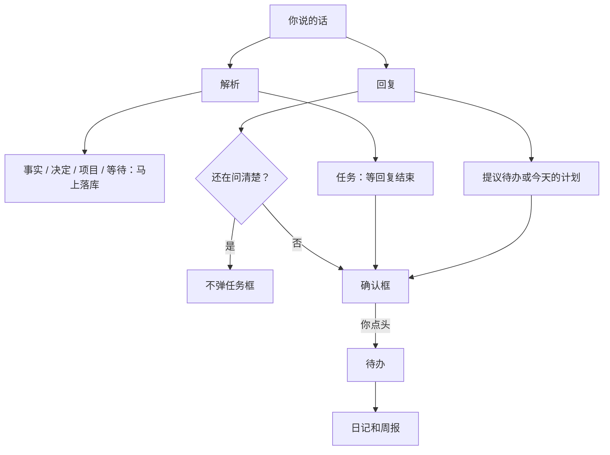

# AI 日程秘书

本地优先的单用户 Android 应用。随口说一件事，它听懂、问清、等你点头才记进待办；晚上对照今天的计划，写成一篇日记。

A local-first, single-user Android secretary. Talk through the day, confirm before anything is saved, and get a diary at night.

[](https://github.com/ZCpioneer/my-day/actions/workflows/ci.yml)
[](LICENSE)

没有账号，没有自己的服务器。聊天、待办、日记都在这台设备上。对话发给 [DeepSeek](https://platform.deepseek.com/)，语音识别和朗读发给[阿里云百炼](https://bailian.console.aliyun.com/)。除此之外没有别的外发。

## 一天是怎么过的

底栏三个入口：**对话**、**待办**、**日记**。设置在右上角齿轮。

| 时候 | 发生什么 |
| --- | --- |
| 早上 | 当天还没说过话时，秘书先开口，帮你把今天收成很少的几件事。 |
| 白天 | 文字或语音都行。事实和「在等谁」会记下；**要变成待办的事一定先弹确认框**，你点头才落库。 |
| 晚上 | 18 点以后、当天还没有日记时，开场改成对照早上的计划问进展。日记在日记页整理，不在对话里写。 |
| 一周 | 日记页可以生成本周周报：完成了什么、没做完什么、下周建议。 |

待办分两栏：**今天**和**以后**。「以后」按项目分组，可以拖拽。带截止日期的未完成事项会在本机提醒；当天还没写日记时，21:00 催一记。

## 它守的几条规矩

- **先确认再记。** 模型不能口头声称「已经帮你记下了」。提议之后，你确认才写入。
- **勾选只在待办页。** 对话里没有「帮你勾掉」的工具，也没有在聊天里写日记的工具。
- **不做长期记忆。** 偏好、目标和感慨不抽取、不保存。留下的是对话、发生过的事、当前的待办和日记。
- **今天就这几件。** 新冒出来的一摊事，秘书先问一句，不立刻塞进今天的清单。今天的计划要单独确认。

## 快速开始

需要 Node.js 20 或更新版本。

```bash
git clone https://github.com/ZCpioneer/my-day.git
cd my-day
npm install
npm run dev
```

浏览器打开终端里给出的本地地址（Vite 默认是 <http://localhost:5173>）。手机宽度下看最接近真机。

然后点右上角齿轮：

1. **DeepSeek API Key**：对话、解析、整理、日记、周报都用它。到 [DeepSeek 开放平台](https://platform.deepseek.com/) 创建。默认模型是 `deepseek-v4-flash`，也可以换成 `deepseek-v4-pro`。
2. **语音 API Key**（可选）：阿里云百炼的 Key，识别和朗读共用。不用语音可以留空。

两把 Key 都只写在设置里，保存在这台设备上。仓库里没有 Key，克隆下来的模板也是空的。

## 装到 Android

只做侧载，不上架。应用 id 是 `com.aisecretary.app`。需要 JDK 21 和 Android SDK 35（用 Android Studio 自带的 JDK 即可）。

```bash
npm run cap:sync
cd android
./gradlew assembleDebug
```

调试包在 `android/app/build/outputs/apk/debug/app-debug.apk`。这个目录已被忽略，不会进 git。设置页底部有版本号和构建时间，用来核对手机上是不是这一包。

`AndroidManifest` 里需要同时有 `RECORD_AUDIO` 和 `MODIFY_AUDIO_SETTINGS`，否则系统已经允许麦克风时，语音模式仍可能被当成拒绝。

## 密钥不会进仓库

| 放在哪 | 会不会被提交 |
| --- | --- |
| 应用设置里的 Key | 不会。在本机 Preferences（浏览器里是 localStorage） |
| `src/debug/default-key.ts` | 不会。给本机调试回退用，`.gitignore` 已排除。缺这个文件时，`npm install` 会从模板复制一份空的 |
| `src/debug/default-key.example.ts` | 会。两行必须是空字符串 |
| `dist/`、调试 APK、`android/app/src/main/assets/public` | 不会。注意：如果回退文件里填了 Key，打出来的包里会带上它，不要把这些产物发给别人 |

提交前可以跑：

```bash
npm run check:secrets
```

它只报告文件位置和掩码，不打印密钥全文。日志里的 Key 同样只显示前 4 位。

真实 API 的质量评估不进单元测试。需要时自己设环境变量再跑，Key 不要写进命令历史以外的文件：

```bash
DEEPSEEK_API_KEY=你的Key npm run eval:parse
```

## 它怎么工作

一句话进来之后，解析和回复同时进行。解析不挡住回复的气泡。任务要等这轮回复结束，才决定弹不弹确认框。



回复层只有三个工具：`list_todos`（读清单）、`propose_todos`（提议记到「以后」）、`set_today_plan`（提议今天做哪几件）。整理、日记、周报是旁边的一次性调用，不进这个工具循环。

数据分两层：

- **时间线**：原始对话，加上结构化的事件和决定。
- **当前状态**：待办、项目、正在等的事。日记按本地日历日保存，周报按 ISO 周（周一开始）。

一天按本地日历划分，不用 UTC。标题是不是同一件事，先去掉空白、忽略大小写，再看未完成标题是否互相包含。

改代码时要守的规则写在 [AGENTS.md](AGENTS.md)。那是给人和编程代理看的，不是产品说明。

## 技术栈

- 界面：Vue 3、TypeScript、Vite，手机宽度
- 壳：Capacitor 7，仅 Android
- 模型：DeepSeek，OpenAI 兼容的 Chat Completions 和工具调用，回复走 SSE 流式
- 语音：百炼 `qwen3-asr-flash` 转写，`qwen3-tts-flash` 朗读
- 提醒：本机通知，不经过推送服务器
- 存储：IndexedDB 和 Capacitor Preferences

## 开发

```bash
npm run dev          # 本地开发
npm test             # 单元测试（不访问网络）
npm run build        # 类型检查并打包到 dist/
npm run cap:sync     # 打包并同步进 Android 工程
npm run check:secrets
```

业务规则尽量写成不依赖界面的纯函数，网络、时间和存储从参数注入。测试在 `src/__tests__/`，用 vitest。推送到 `main` 的分支和 pull request 会跑测试和构建。

这是作者自己每天在用的工具，取舍都围绕这一个人的一天。修 bug 和小改进可以直接提 pull request。想加一块新能力，请先开 issue 说清楚它怎么嵌进「早上计划、白天确认、晚上日记」这条线。

## 故意不做的事

- 自己的后端、账号、多用户
- 长期记忆或偏好库
- 在对话里勾选待办、在对话里写日记
- 把没确认的任务静默写进去
- iOS 和应用商店上架
- 除 DeepSeek 与阿里云百炼以外的数据外发

## 许可

[MIT](LICENSE)。Copyright (c) 2026 ZCpioneer.
